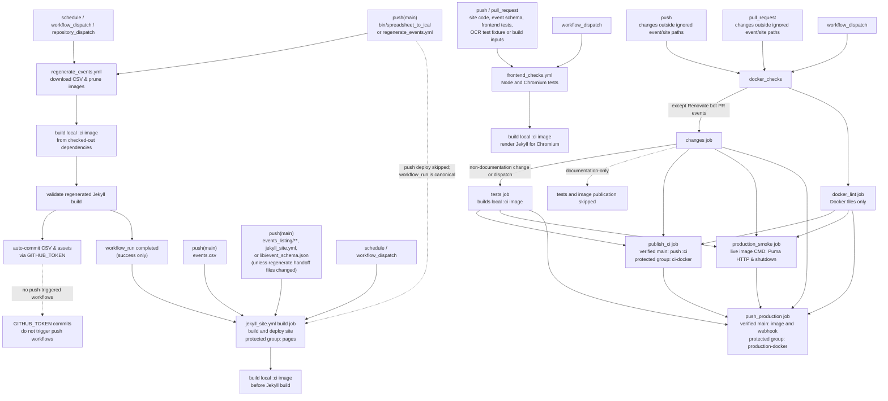

# GitHub Actions Workflow Map

This document tracks the trigger and dependency flow between the repository's GitHub Actions workflows.

Update this chart whenever a workflow trigger, cross-workflow dependency, concurrency rule, or auto-commit path changes.

Solid arrows mean "can trigger / leads to a new workflow or job path". Dotted arrows are informational links and do not trigger a new workflow.

Design notes:

- `jekyll_site.yml` intentionally stays independent from `docker_checks.yml`; the site deploy should not wait on backend-oriented checks unless a concrete breakage proves that coupling is needed.
- `frontend_checks.yml` runs Node tests and builds a local Jekyll site for the Chromium form test. Changes to the event schema and the test's OCR flyer fixture trigger the workflow. Changes limited to published flyer images skip it.
- When the same push also triggers `regenerate_events.yml`, the push-triggered Jekyll deploy is skipped and the `workflow_run` path from `Regenerate events` becomes the canonical deploy path.
- Changes limited to root `AGENTS.md`, `README*`, or files under `docs/` reach the `changes` job and skip Docker tests and image publication. Markdown elsewhere, including workflow, site, and runtime paths, still runs tests.
- Renovate bot pull request events from same-repository `renovate/` branches skip Docker Checks jobs when the triggering actor is also Renovate. Human-triggered events and fork pull requests still run. Push checks compare the latest push, while pull request checks compare all branch changes against the base; skipping the bot pull request does not guarantee the same checks ran for an accumulated diff.
- Push triggers remain enabled for Renovate branches because `.github/renovate.json5` uses `automergeType: 'branch'`; Renovate needs passing branch checks before it can merge those updates directly.
- Runtime publication guards and the site checkout use the repository's default
  branch. Native branch filters remain `main`; Cloudflare's `--branch=main` is
  the production deployment channel and remains independent of the checkout ref.
- `tests` builds a local `:ci` image without package write access. `publish_ci` is the only Docker Checks job that pushes the shared `:ci` tag.
- For each eligible push (including Renovate branches), non-skipped pull request or manual run, `production_smoke` builds the full `live` image and runs its normal CMD and user. `.github/scripts/production_smoke.sh` checks a real HTTP `GET /health`, Puma startup and a clean shutdown within 10 seconds. It uses `APP_ENV=test` to skip Google credentials and `--network none` with a loopback probe; production configuration and external integrations are not tested. Production publication depends on this check and the tests. Test and CI configuration changes can therefore publish an image too.
- The `:ci` and production publication jobs and eligible Pages build jobs do not cancel active jobs; failed regeneration does not enter the Pages concurrency group; a newer pending job can replace an older pending job. Each qualifying backend run builds the complete checked-out revision. Old-ref reruns can update moving tags.
- `regenerate_events.yml` and `jekyll_site.yml` build the `ci` target from the checked-out dependencies before invoking Jekyll. Both reuse the shared `ci` build cache without waiting for `docker_checks` to publish the moving tag; this also handles Renovate branch merges that leave that tag behind the current lockfile.
