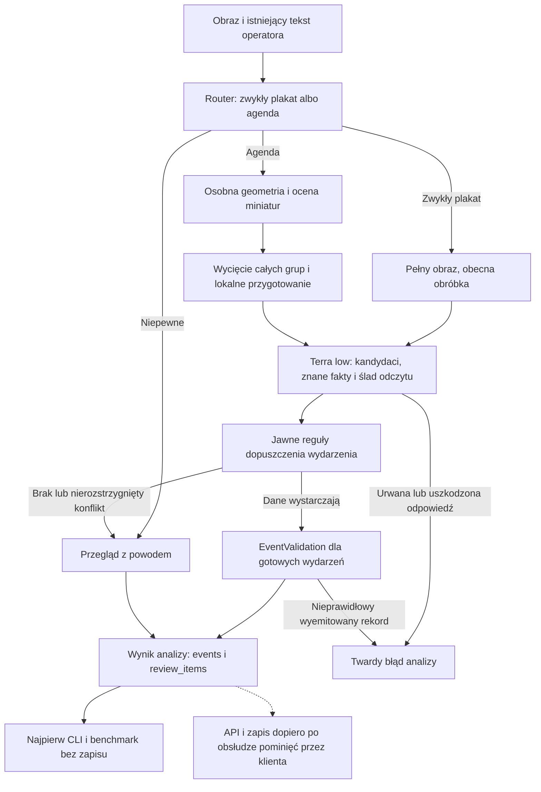

# OCR — diagnoza, architektura i selektywny plan ulepszeń

## Wycofanie `selected` — 19 listopada 2026

CLI i benchmark obsługują `legacy` i `source`. Usunięto eksperymentalny
`selected` wraz z routerem, geometrią, kadrowaniem, maskowaniem i Judge
miniatur. Benchmark z `--cases` domyślnie wybiera `source`. Polecenie
`--score-only` nadal ocenia zapisane wyniki `selected` na historycznej referencji.
API używa `legacy`. Integracja `source` z API pozostaje w zakresie MCA-173.

## Aktualny wynik: prosty odczyt źródła — 15 listopada 2026

Wdrożono **lokalny, jawnie wybierany `--workflow source`**: jeden pełny obraz,
jeden reader, walidacja kanonicznego kontraktu i `review_items`. Bez routera,
geometrii, maskowania, Judge, końcowego verifiera ani automatycznych ponowień.
Nadal powstają osobne rekordy wydarzeń; **nie wycinamy ich obrazów**.
`source` nie jest podłączony do API ani zapisu arkusza. Domyślne `legacy`
obsługuje PDF. Wyniki `selected` poniżej dokumentują wcześniejsze pomiary.

```sh
./dockerized.sh bundle exec ruby bin/ocr --workflow source --effort medium \
  --fallback-year 2026 --json --artifacts-dir tmp/ocr-one-source flyer.jpg
./dockerized.sh bundle exec ruby bin/ocr_benchmark --workflow source \
  --cases test/fixtures/ocr/cases_holdout_20261115.json --effort medium \
  --fallback-year 2026 --repeat 1 --output tmp/ocr-source-medium.json
```

Katalog artefaktów musi być nowy lub pusty. Zapisywane są dokładne bajty obrazu,
żądanie i odpowiedź oraz hashe źródła, promptu, schematów i katalogu miejsc.
Nieobrazowe wejście jest odrzucane przed wywołaniem modelu. Błąd próby zachowuje
diagnostykę i jest widoczny jako błąd; nie oznacza pustej poprawnej ekstrakcji.

### Referencja i normalizacja

Usunięto alias łączący instytucję Porta33 ze szkołami Escola da Vila/Escola do
Porto Santo. Nazwy zachowują tożsamość; brak zakazu używania instytucji jako
venue, gdy źródło rzeczywiście ustala tę rolę.

Historyczne `cases.json` pozostaje bez zmian (53 oczekiwania, 159 w trzech
próbach; SHA256 `60c80fe769e047520b2c30ed75d25011e33685dfa8e447158be41b0c8f2aeda9`).
Uzgodnione `cases_v2.json` ma **52 oczekiwania**: warsztaty i Festa da Escola
wymagają review z powodu niepotwierdzonego venue; nazwany teren LIFEDUNAS jest
dopuszczalnym miejscem wizyt bez dopisywania punktu zbiórki. Viagem +65 pozostaje
kandydatem do decyzji o polityce. Referencja obrazowa nie wymaga faktów znanych
wyłącznie z dodatkowego programu internetowego. Klasyfikacja layoutu nie jest
warunkiem poprawnego odczytu; brak expected_route oznacza brak oceny tej metryki.

Replay tych samych 30 zamrożonych odpowiedzi: v1 **148/159**, v2 **152/156**
w pełni zgodnych sprawdzanych rekordów. To korekta referencji, **nie poprawa
readera**. Dwa braki end_time pozostają. Świeży source low na historycznych
10 źródłach: 49/52 pełnych zgodności, dwie pominięte wizyty LIFEDUNAS i brak
end_time FAP, zero awarii. Nie przedstawiać tego jako idealnego rozpoznawania.

### Nowe źródła: low, medium i low z weryfikacją

Dziesięć wcześniej nieużytych w tych eksperymentach archiwalnych WebP obejrzano
bez OCR. Referencję i hashe zamrożono **przed generacją**. Jedna próba low i medium
na źródło; potem nowy kontekst Terra low dla każdego dokładnego końcowego rekordu
low. Verifier nie otrzymał golda, etykiet ani komentarzy recenzenta; nie naprawiał
rekordów. Schemat i instrukcje weryfikacji przygotowano przed wynikami low.
To archiwalne obrazy publikacji, nie pełne oryginały przesyłanych plików.

| Wariant na tych samych 10 obrazach | Emisje | Pełna zgodność sprawdzanych pól / 21 | Wywołania | Znany koszt razem | Średnio / obraz |
| --- | ---: | ---: | ---: | ---: | ---: |
| Terra low | 20 | 19/21 | 10 | $0.04538 | $0.00454 |
| Terra medium | 21 | 21/21 | 10 | $0.06171 | $0.00617 |
| Low + końcowy verifier Terra low | 17 | 17/21 | 30 | $0.09248 | $0.00925 |

Wszystkie 50 wywołań tego etapu (w tym 10 historycznych) zakończyły się bez
błędu technicznego. Koszty pochodzą z metadanych SDK i zawierają obserwowany
cache, nie są fakturą ani gwarantowaną stawką. Odczyty low/medium wykonywano
współbieżnie; to porównanie jakości, nie kontrolowany test latencji/cache.
Verifier kosztował dodatkowo $0.04710/20 rekordów. Medium kosztowała w tej
próbie mniej niż low+verifier i zachowała większe pokrycie. Jeden wynik nie
ustala globalnego rankingu modeli.

**Najważniejsze ustalenia audytu wszystkich wyemitowanych pól:**

- Low skleiła dwa wieczory Pedro David (04 i 05 września, 00H–04H) w jeden
  ciągły zakres 04–05/09 i pominęła godzinę początku. To istotny błąd dat/
  podziału wydarzeń; bez start_time nie nazywać go dokładnie 28 godzinami.
- Medium zachowała dwa wystąpienia i godziny. Jednak cztery rekordy DJ mają
  Court Social Club jako organizatora na podstawie marki/miejsca, bez jasnej
  atrybucji roli. To niepoparte wnioskowanie o roli, nie dowód faktycznie
  innego organizatora. **21/21 nie oznacza 100% precyzji wszystkich faktów.**
- Verifier dopuścił daty błędnego zakresu, zatrzymując ten rekord za organizatora.
  Odrzucenie rekordu nie dowodzi wykrycia jego błędu czasowego. Odrzucił Court
  jako organizatora Resmas, ale zaakceptował tę samą rolę przy Pedro David
  z tego samego plakatu. Pozostał więc jeden zaakceptowany wniosek o organizatorze.
- Verifier odrzucił miejsce wystawy Porta33 zaakceptowane w zamrożonej referencji:
  rozbieżność interpretacji roli instytucji/lokalu, a nie dowód błędnego miejsca.
  Łącznie 17 akceptacji, 3 review, zero awarii. W akceptowanych rekordach nie
  znaleziono kolejnego jednoznacznie sprzecznego istotnego faktu; pozostaje też
  ujawniona niejednoznaczność układu podpisu Festa das Vindimas.
- Oba readery wstrzymały 15 Lazy Sundays i zawody pływackie zgodnie z przyjętą
  ostrożną polityką miejsca. Poncha jako venue pozostaje interpretacją, nie
  dowiedzionym fałszem. Jedno zbiorcze review zawodów nie spełnia dwóch
  oczekiwanych review dat: wynik 16/17 nie jest niebezpieczną emisją.

**Decyzja:** preferować jeden source reader **Terra medium do kolejnego etapu**,
bez stałego verifiera per wydarzenie, głosowania i pętli napraw. Domyślnego
modelu/effort API ani CLI nie zmieniono; medium wybiera się jawnie. Nie wdrażać
samoczynnego zapisu: niezależny verifier okazał się niespójny, a samo Admission
sprawdza kontrakt i deklaracje, nie prawdziwość faktów. Następna mała paczka:
uściślić rolę opcjonalnego organizatora oraz dwie daty versus ciągły zakres,
zachować ujawnione błędy jako regresje; ocenić na kolejnym zamrożonym zestawie.
Nie stroić promptu i ponownie nazywać tych samych 10 obrazów holdoutem.
Dopiero później integracja API z jawnym review i E2E granicy zapisu.
MCA-173/174 pozostają otwarte. MCA-175/176 dotyczą wycofanego `selected`.

### Odbiór kodu i materiały

Terra przygotowała implementację, Sol sprawdził kontrakt wejść/artefaktów i
przeprowadził audyt źródłowy. Poprawiono odrzucanie nieobrazowych plików oraz
ryzyko pomieszania starej odpowiedzi z nową próbą w katalogu artefaktów.
Pełny lokalny test: **383 testy, 2188 asercji, zero błędów, dwa pominięcia**;
Rubocop: **86 plików, zero naruszeń**. Brak zapisu wydarzeń, push, CI i wdrożenia.
Zmiana komunikatów retry na stderr zachowuje czysty JSON stdout w CLI.

[Trwałe zestawienie wyników i ograniczeń](ocr-source-evaluation-20261115.json),
[zamrożona referencja](../test/fixtures/ocr/cases_holdout_20261115.json).
Lokalne pełne dowody: `tmp/ocr-source-delivery/` — manifest, frozen, low/medium
results, verifier requests/results, aggregate, logi testów. Lokalny
[raport z obrazami i odpowiedziami](../tmp/ocr-source-delivery/report.html).
Sekcje poniżej są historią eksperymentów; opisane tam „następne kroki” i stan
niezacommitowanej paczki odnoszą się do tamtych etapów, nie do stanu powyżej.

---

## Koszt plakatu i kolejność dalszej pracy — 15 listopada 2026

Przeliczenie zapisanych 30 odczytów pełnego oryginału przez Terra low:

| Wejście / etap | Średni koszt USD | Zakres w próbie |
| --- | ---: | ---: |
| Plakat spoza miesięcznych agend, 18 analiz | $0.00355 | $0.00124–0.00971 |
| Cała agenda miesięczna, 12 analiz | $0.01477 | $0.01036–0.02404 |
| Verifier Terra, jedno wydarzenie, 12 ocen | +$0.00508 | Osobny eksperyment, nie koszt całego pipeline |
| Verifier Luna, jedno wydarzenie, 12 ocen | +$0.000564 | Osobny eksperyment, słabszy wynik kontroli dodatnich |

To metadane rzeczywistych odpowiedzi z cache, nie faktura produkcyjna ani
stała cena za obraz. Odczyt całej agendy generuje kilka/kilkanaście rekordów
w jednym wywołaniu. Przy 10 wydarzeniach arytmetyczny szacunek z verifierem
Terra wynosi $0.01477 + 10 × $0.00508 ≈ **$0.066**. Nie zmierzono jeszcze
tego pełnego zestawu kroków razem; koszt zależy od obrazu i długości odpowiedzi.
[Rozbicie po źródłach](../tmp/ocr-final-verifier-review/cost-per-source.json).

**Kadrowanie w porównaniu:** reader pełnego oryginału sam zwracał oddzielne
rekordy. Eksperymentalny `selected` wycinał grupy miesięcznej agendy i oceniał
miniatury. Domyślne `legacy` ma własne przygotowanie całego obrazu i prompt.

Plan przyjęty na etapie tego porównania:

1. Mały test **Gemini 4 Hydrogen jako readera pełnego oryginału**, potem Terra
   jako porównanie lub jawne zastępstwo po awarii. Bez automatycznej kaskady
   pytającej kolejny model, aż któryś dopuści niepewny fakt. Dostępność i
   poprawność mierzymy oddzielnie.
2. MCA-174: źródłowa referencja i aliasy miejsc; zachować stary gold i odrębnie
   uzgodnić nową wersję. Nie podnosić wyniku przez nagradzanie zgadywania venue.
3. MCA-173: prosty wariant CLI z pełnym obrazem, wspólnym kontraktem kandydatów,
   walidacją i review; bez routera, geometrii i Judge miniatur na domyślnej
   ścieżce. Osobne rekordy wydarzeń zostają, wycinanie ich obrazów nie jest
   wymagane. Kadry mogą pozostać narzędziem ręcznej diagnozy.
4. Dopiero potem pełny pomiar reader + końcowy verifier Terra na nowych
   źródłach; jeden reader Terra medium jako prostszy konkurent. Wybór na
   podstawie niepopartych faktów, użytecznego pokrycia, awarii i kosztu.
5. Oddzielna integracja API z jawnym review i testem granicy zapisu. Usunięcie
   starej implementacji po odbiorze zamiennika; nie utrzymywać bezterminowo
   dwóch rozbudowanych ścieżek. MCA-175/176 do decyzji o wycofaniu po tej zmianie.

**Wykonana próba Hydrogen → porównanie Terra:** trzy pełne oryginały (DJ,
lipiec, październik), po jednym odczycie każdego modelu, low; **6/6 wywołań
bez błędów technicznych**, oryginalny schema sprawdzony lokalnie. Gemini
`gemini-4-hydrogen` wymagał obejścia brakującego wpisu w rejestrze SDK oraz
usunięcia minItems/maxItems wyłącznie z wysyłanej tablicy panels. Pełne
ograniczenia nadal obowiązywały w lokalnej walidacji. To porównanie modeli
z adapterem, nie identycznego mechanizmu wymuszania schematu ani budżetu low.

Hydrogen zwrócił 2/19/9 wydarzeń, Terra 2/17/8. Wyższa liczba nie oznacza
lepszej jakości: Hydrogen przyjął **Festa da Escola z niepotwierdzonym venue
Porta 33 — Escola da Vila**, już w surowym kandydacie. Terra jawnie wstrzymała
ten rekord. Różnica dwóch LIFEDUNAS jest zależna od polityki konkretności
nazwanego terenu, nie wymyślonej lokalizacji. Oba modele zatrzymały warsztaty,
Dia dos Avós i wystawę bez początku; oba zwróciły poprawne daty DJ bez
dopisania następnego dnia. To kontrola wskazanych regresji, nie pełny audyt
każdego pola ani pomiar na nowych źródłach. **Terra pozostaje bazą; Hydrogen
nie jest jeszcze kandydatem do samodzielnej akceptacji.**

Koszty Terra z tej próby: DJ $0.00638, lipiec $0.02195, październik $0.01548.
Gemini nie zwraca natywnej wyceny w obecnym SDK. Arytmetyka tokenów według
[standardowego cennika Gemini](https://aistudio.google.com/docs/pricing#gemini-4-hydrogen)
($1.50/M input, $7.50/M output łącznie z thinking) daje odpowiednio $0.01836,
$0.06192, $0.05477. To wycena bazowa, bez nieujawnionych opłat zapisu cache
i bez potwierdzenia taryfy konta/faktury; nie dodawać thinking drugi raz,
ponieważ RubyLLM wlicza je już w output_tokens. Różny cache ogranicza
porównanie. [Surowe wyniki](../tmp/ocr-hydrogen-original-probe-20261115/results.json),
[manifest i dokładne żądania](../tmp/ocr-hydrogen-original-probe-20261115/manifest.json).
Bez zmian runtime, zapisu wydarzeń i nowych commitów.

## Decyzja po sprawdzeniu finalnego verifiera — 15 listopada 2026

[Pełny raport z oryginałami, kandydatami i odpowiedziami modeli](../tmp/ocr-final-verifier-review/report.html).
[Zamrożone przypadki](../tmp/ocr-final-verifier-review/manifest.json),
[agregacja](../tmp/ocr-final-verifier-review/aggregate.json).

**Upraszczać do jednego readera oryginału + walidacja w kodzie + jawne review.**
Najlepszym kandydatem do następnego eksperymentu jest końcowy verifier Terra
przez structured chat, w osobnym kontekście, oceniający dokładny finalny rekord.
Nie wdrażać jeszcze jego akceptacji jako zgody na automatyczny zapis.
Obecny Judge ocenia obrazy przed readerem; nie widzi później dopisanych faktów.

Nowa próba: 12 kandydatów z 7 obrazów — pięć istotnych błędów, jeden błąd
pisowni i sześć kontroli. Trzy błędne przypadki pochodzą z obserwowanych
odpowiedzi/projekcji, trzy są syntetyczne. Native Judge: dwa powtórzenia;
chat: jedna próba, low, krótki dowód źródłowy, bez przepisywania eventu.

| Konfiguracja | Zatrzymane istotne błędy | Przyjęte poprawne kontrole | Pisownia Resmás zamiast Resmas |
| --- | ---: | ---: | --- |
| Native Judge Luna | 4/5 w obu powtórzeniach | 0/6 w obu | Nie wykryta we właściwej grupie |
| Native Judge Terra | Brak oceny | Brak oceny | Endpoint/konto: model_not_found |
| Chat Luna low | 5/5 we właściwej grupie | 4/6 | Niewykryta; odmowa przez błędny odczyt godzin |
| Chat Terra low | 5/5 we właściwej grupie | 6/6 | Przepuszczona |

Wszystkie 24 wywołania chat zakończyły się poprawnie. Native Terra zwróciła
24 razy ten sam problem dostępności modelu; nie jest to ocena rozumowania
ani niedostępność Terra w chat. Native Luna przepuściła zmyślony początek
wystawy, odrzucając wszystkie kontrole. Powtórzenia mają identyczne rozkłady
i cache; nie są niezależnymi przykładami.

Luna chat nie odczytała pionowych godzin Sun Day. Przy targach potraktowała
16:00 jako godzinę każdego dnia; istniejący kontrakt wiąże ją z pierwszym
dniem zakresu, a opis zawiera różny harmonogram. Verifier nie dostał tej
reguły jawnie. Nie zmieniono etykiety kontroli ani danych po pomiarze.
Oba chaty powtórzyły niepoprawne Resmás jako rzekomy dowód ze źródła:
wygenerowany cytat nie gwarantuje prawdy.

Znany koszt odpowiedzi: native Luna $0.0056211/24, chat Luna $0.00676685/12,
chat Terra $0.0609135/12; cache i koszty błędów ograniczają porównanie.
To diagnoza na wybranych przypadkach, nie holdout, pełny pipeline ani
ranking modeli. Native i chat różnią też endpoint, reasoning i instrukcje.
Sol zweryfikował oryginały, wyniki i offline serializację native: właściwy
obraz, kandydat i pytania, bez wycieku etykiet. Terra przygotowała probe.

Kolejność: MCA-174 — referencja źródłowa i aliasy tego samego bytu; MCA-173 —
prosty wariant CLI oraz pomiar końcowego verifiera w trybie obserwacyjnym na
nowych źródłach. Później porównać jeden reader Terra medium jako prostszego
konkurenta. MCA-175/176 pozostają otwarte; na razie nie rozbudowywać maskowania
i wyjątków Judge. Nie wdrażać głosowania ani automatycznych pętli napraw.
Verifier jednego eventu to jedno dodatkowe wywołanie na event: wcześniejsze
30 odczytów + 154 emisje oznaczałyby 184 wywołania, nie 60. Batch wymaga
osobnego pomiaru. Dopiero udokumentowany wynik całego pipeline i E2E granicy
zapisu mogą uzasadnić osobną integrację API.

W tym etapie zmieniły się raport i artefakty diagnostyczne, nie runtime.
Nie zapisano wydarzeń, nie wykonano nowego commita/push/deploy. Wyniki testów
kodu w sekcji poniżej pochodzą z poprzedniego etapu, nie z tego eksperymentu.

## Odbiór i kierunek uproszczenia — 15 listopada, wieczór

Paczka API OCR i opcjonalnego organizatora jest lokalnie zacommitowana jako
`8f2cc77` (20 plików). Dokładny indeks i hook commita: 305 testów, 1487 asercji,
zero błędów, dwa pominięte testy. Review Sol oraz audyt pt-PT zakończone.
Nie wykonano push, CI ani wdrożenia. Eksperymentalny workflow poniżej pozostaje
osobną, niezacommitowaną pracą; nie jest podłączony do ingestii API.

**Rekomendowany kierunek: jeden reader na zachowanym oryginale, następnie jawne
Admission i review.** Nie rozbudowywać teraz wyjątków maskowania i weta Judge.
To wybór kierunku następnej małej implementacji, nie deklaracja gotowości
nowego API. Ochroną jest poprawność źródłowa; sam JSON/schema i deklaracja modelu
o źródle nie dowodzą prawdziwości wydarzenia.

**Brama automatycznej ingestii pozostaje niespełniona:** późniejsza kontrola DJ
ujawniła dwa niepoparte `end_date` w jednym świeżym przebiegu. Uproszczony reader
jest kandydatem do ekstrakcji i jawnego review, nie zatwierdzonym automatycznym
publikatorem. Nie dopisywać wyjątków naprawiających konkretny plakat ani
traktować `date_source=main_text` jako niezależnego potwierdzenia daty.

Porównano 10 tych samych obrazów × 3 świeże przebiegi × 2 konfiguracje, bez
zapisywania wydarzeń. Reader Terra low, original detail, bez upscale. Wariant
oryginału używa tego samego schematu kandydatów i Admission, lecz pomija router,
geometrię, kadrowanie i Judge; instrukcję standalone zastąpiono instrukcją całego
źródła. To porównanie całych konfiguracji, nie izolowany eksperyment maskowania.
Wszystkie wyniki poniżej pochodzą z zamrożonego kodu **sprzed naprawy dostępności
dodatkowego tekstu**; późniejszych poprawek nie przypisujemy do tych wywołań.

| Pomiar | Dotychczasowy selected | Oryginał + jeden reader |
| --- | ---: | ---: |
| Przebiegi | 30 | 30 |
| Wywołania modeli z odpowiedzią | 176 | 30 |
| Błędy techniczne | 2: crop i Judge 503 | 0 |
| Wyemitowane rekordy | 121 | 154 |
| Pełna zgodność sprawdzanych pól starego golda | 119/159 | 148/159 |
| Nieocenione oczekiwania przez błędy techniczne | 26 | 0 |
| Dopasowane wystąpienia z pominiętym polem | 0 | 2: FAP end_time |
| Niepoparte istotne fakty znalezione w audycie źródeł | 2 venue warsztatów | 0 |

W wariancie oryginału odnotowano też błąd transkrypcji `Resmás` zamiast `Resmas`
w opisie jednego Sun Day. Nie jest więc bezbłędny. Cztery emisje LIFEDUNAS są
poza ścisłym goldem: mają źródłowo nazwany teren projektu, lecz polityka
wystarczającej konkretności miejsca nadal pozostaje osobną decyzją. Dziewięć
ścisłych pominięć to dwa warsztaty i Festa da Escola w każdym powtórzeniu —
celowa ostrożność wobec niepotwierdzonego miejsca. Nie zmieniono golda ani
historycznego mianownika 159. Stary gold nagradza właśnie dwa niepoparte venue
w selected; dlatego jego zgodność nie jest miarą precyzji.

Pierwsza sekwencyjna próba: selected 334 s i 64 wywołania, oryginał 167 s i 10
wywołań. Powtórzenia 2–3 wykonywano współbieżnie i służą ocenie powtarzalności,
nie izolowanemu pomiarowi szybkości. Koszty z metadanych wszystkich odpowiedzi:
selected $0.2805 (niepełne przy błędach), oryginał $0.2411. Cache różnił się
między próbami; to nie gwarancja kosztu produkcyjnego ani odczyt faktury.

Każde wyemitowane pole porównano bezpośrednio z obrazem albo z identycznym,
już sprawdzonym rekordem; wszystkie zmiany oceniono ręcznie. Przypisania
organizatora z kredytu lokalnej karty pozostają interpretacją przyjętej polityki,
a rok Palmito pochodzi z jawnego fallbacku. Zestaw ma 10 niezależnych źródeł,
nie 60; nie dowodzi generalizacji na nowe układy.

**Potwierdzone poprawki następnej paczki:** scorer odróżnia tożsamość
podwydarzenia od wzmianki o festiwalu, wymaga daty konkretnego review i nie
zalicza jednego review wielokrotnie. Replay wcześniejszego benchmarku przy
niezmienionych odpowiedziach/goldzie: fałszywe alarmy Festival 2→0, poprawnie
dopasowane review 32→29; liczniki wydarzeń i pól bez zmian. Nie myli błędnej
godziny lub venue podwydarzenia z emisją całego festiwalu.

Źródło błędu lipcowego: reader zadeklarował venue dwóch warsztatów jako `additional_text`,
choć w danym przebiegu ten tekst był nieobecny. Chodzi o dwa rekordy z jednej
odpowiedzi readera, nie dwa niezależne potwierdzenia. Mechaniczna kontrola
dostępności źródła kieruje taki rekord do review. Sama obecność dodatkowego
tekstu nadal nie dowodzi jego prawdziwości ani zgodności z wydarzeniem.

Naprawa obejmuje cztery źródła (`location`, `date`, `time`, `price`): niedostępne
`additional_text` nie występuje w enumach wysyłanych do modelu i jest również
odrzucane lokalnie. Podpis w zrzucie ekranu pozostaje treścią obrazu. Replay
60 zapisanych prób przez sam guard odrzucił 14 rekordów: dwa błędne venue
warsztatów i 12 poprawnych DJ z błędnie opisanym źródłem. To pokazuje potrzebę
spójnego kontraktu generowania, nie uzasadnia osłabienia kontroli.

Celowana kontrola nowego schematu/promptu: **8 analiz** (lipiec i DJ, original
po trzy próby, selected po jednej), bez błędów technicznych. Wszystkie osiem
rekordów DJ poprawnie wskazuje obraz jako źródło; wszystkie próby wstrzymują
oba warsztaty i Dia dos Avós. Jednak original run 1 dopisał DJ daty końca
12 i 13 września przy startach 11 i 12 września i godzinach 00:00–04:00.
To dwa niepoparte 28-godzinne przedziały, wykryte przez audyt i scorer.
Pozostałe trzy analizy DJ nie mają tego błędu. Nie można przypisać go przyczynowo
zmianie promptu na podstawie jednej niedeterministycznej próby. Nie nadpisano
wyników nieudanych ani nie wdrożono obejścia. [Audyt](../tmp/ocr-source-availability-review/source-audit-post-fix.md),
[wynik scorera](../tmp/ocr-source-availability-review/score.json),
[audyt wszystkich 71 rekordów lipcowych](../tmp/ocr-source-availability-review/source-audit-july-post-fix.json).

Końcowa walidacja kodu: **363 testy, 2054 asercje, zero błędów, dwa pominięcia**;
RuboCop 84 pliki bez naruszeń, testy JS 6/6. Sol sprawdził osobno poprawkę
tożsamości w scorerze oraz granicę dostępności źródeł. To nie zastępuje oceny
semantycznej odpowiedzi modelu. Te poprawki pozostają lokalnie poza commitem
API `8f2cc77`.

Minimalne kontrprzykłady z hashami oryginałów zachowano też poza `tmp`:
[niedostępny tekst](../test/fixtures/ocr/regressions/unavailable_additional_text.json)
i [błędne daty końca DJ](../test/fixtures/ocr/regressions/dj_next_day_end_dates.json).
Drugi jest dowodem nierozwiązanego błędu generacji, nie testem naprawionej reguły.

Dowody: [pełny scorer selected](../tmp/ocr-architecture-review/selected-all-score.json),
[pełny scorer oryginału](../tmp/ocr-architecture-review/original-all-score.json),
[audyt lipca](../tmp/ocr-architecture-review/source-audit-july.json),
[audyt października](../tmp/ocr-architecture-review/source-audit-october.json),
[audyt pozostałych źródeł](../tmp/ocr-architecture-review/source-audit-rest.md).
Manifesty, dokładne prompty, obrazy, surowe odpowiedzi i zamrożone pliki są w
`tmp/ocr-architecture-review/`. Do czasu decyzji o wycofaniu masked workflow
MCA-175/176 pozostają otwarte; priorytet ma MCA-174 i wspólny kontrakt źródeł.

---

Poniższe pomiary historyczne obejmują eksperymentalny workflow P0–P3 w CLI i benchmarku. Testy jednostkowe i E2E działały offline na zamockowanych granicach modeli. Po podniesieniu limitu OpenAI wykonano również 120 rzeczywistych przebiegów całego workflow. Wynik nie spełnił ówczesnego kryterium pokrycia.

## Aktualny kontrakt — 15 listopada 2026

Organizator jest opcjonalny w kanonicznym `lib/event_schema.json`: brak pola lub pusty string nie blokują wydarzenia. Podana nazwa nadal wymaga co najmniej dwóch niebiałych znaków i maksymalnie 100 znaków; same spacje, błędny typ i `null` w bezpośrednim finalnym payloadzie są niepoprawne. Kandydat OCR może mieć `organizer: null`; istniejące czyszczenie usuwa puste wartości przed końcową walidacją. Ta sama definicja schematu steruje walidacją formularza/API, ingestii, obu ścieżek OCR i listą wymaganych pól w Admission/prompcie — bez osobnego wyjątku walidatora.

Instrukcja organizatora preferuje przypisanie przy konkretnym wydarzeniu, następnie podpis w jego kafelku lub jasno wskazanego gospodarza samodzielnego plakatu. Podpis grupy nie nadpisuje wyjątku konkretnej pozycji; globalne logo wydawcy i nieopisany pasek sponsorów nie dostarczają organizatora. Nieznany organizator pozostaje pusty, bez samodzielnego powodu review. Reguły dat, miejsca, banerów i źródeł pozostają bez zmian.

Słownik to [known_places.json](../lib/known_places.json): mapa `nazwa kanoniczna → aliasy`, 30 zachowanych miejsc, bez nieużywanych `id`/`scope`. Nazwa jest naturalnym kluczem; nie ma osobnego identyfikatora ani warstwy zgodności ze starym plikiem. `Balaloa Beach Bar` i jego dotychczasowy alias `Balaloa Beach Bar, Praia do Penedo` były już na liście. To sugestie normalizacji, nie lista dozwolonych miejsc ani dowód lokalizacji.

Poniższe wyniki z 14 listopada dotyczą wcześniejszego kontraktu z wymaganym organizatorem. Replay `99/106` z [audytu HTML](../tmp/ocr-prompt-audit/report.html) był symulacją na zapisanych odpowiedziach; nie traktujemy go jako wyniku nowego wdrożenia. Kontrola po wdrożeniu: **50/53 zgodnych wystąpień**, zero błędów sprawdzanych pól i zero dodatkowych rekordów w jednym rzeczywistym przebiegu samego czytnika Terra low na tych samych 10 zamrożonych wejściach. Wszystkie 5 zwykłych pozytywów przechodzi; Rali i szczepienia bez miejsca pozostają w review. Pominięte pozostają dwa lipcowe warsztaty i Festa da Escola z powodu miejsca. Nie jest to nowy pełny benchmark geometrii/Judge ani wyczerpujący audyt organizatorów/opisów. Surowy scorer nadal nalicza jeden wcześniej wykazany fałszywy alarm Festival Colombo na podstawie wzmianki w opisie wizyty DRABL; tej logiki ani gold nie zmieniano. Koszt 10 wywołań: około **$0.1098** według zapisanych metadanych/tokenów. [Wynik](../tmp/known-places-change/live-reader-score.json), [surowe odpowiedzi](../tmp/known-places-change/live-reader-results.json).

Odbiór: faza Red potwierdziła wymagany organizator/pustą etykietę przed zmianą; następnie **343 testy / 1867 asercji**, zero błędów; RuboCop: 84 pliki bez naruszeń; oba testy JS przechodzą. Wyrenderowane strony sprawdzono w przeglądarce na mobile/desktop: organizator opcjonalny w formularzu, Contactos bez organizatora, poprawny JSON-LD bez fikcyjnej organizacji. Audyt pt-PT wykonano dla obu zmienionych szablonów; nie przyjęto sugestii dotyczących niezmienionej treści ani fałszywego alarmu nawiasów wynikającego z odczytu surowych gałęzi Liquid. [Log audytu](../tmp/known-places-change/linguistic-audit.log). Przegląd zakresu: [AGY Brain](../.agy-staff/jobs/staffer-mwhhnylo-ac8d5ca6.result.md).

## Historyczny wniosek — kontrakt sprzed 15 listopada

Rzeczywisty benchmark ujawnił regresję pokrycia po integracji konserwatywnych kandydatów z końcowym schematem Event: cztery warianty przyjęły tylko **62–68 ze 159 oczekiwanych wystąpień** każdy. Czytnik nadal rozpoznaje wiele poprawnych dat, godzin i miejsc, ale pusty organizator lub opis zatrzymuje je w `Admission`. Po doprecyzowaniu kontraktu poprawił się odczyt miesięcznych grup, ale organizator nadal wymaga źródłowego potwierdzenia; wyższa rozdzielczość nie usuwa tego ograniczenia.

Pełny pomiar i jawne wyniki częściowe już działają. Opis i kategoria mogą być teraz tworzone z odczytanych faktów. Organizator pozostaje wymagany przez kanoniczny schemat. Następne problemy to źródła bez ustalonego organizatora oraz niestabilne zatrzymywanie całych grup przez Judge. Kryterium 53/53 na przebieg pozostaje niezaliczone; nie przełączamy ingestii produkcyjnej.

### Sprawdzenie po uproszczeniu

Ustawienie wybranego workflow: **Terra low, original, bez powiększenia**. Na identycznych obrazach i politykach z pierwszego przebiegu poprzedniego native-original uruchomiono nowy czytnik dla wszystkich 10 źródeł: **27/53 ścisłych wystąpień wobec 23/53**. Lipiec 5→7, wrzesień 8→9, październik 6→7, listopad 4→4. Brak błędów sprawdzanych pól, nieuprawnionych pominięć dopuszczonych do wyjścia i dodatkowych rekordów; z trzech lipcowych niejednoznaczności dwie pozostały w review, jedna nie trafiła do czytnika wskutek zachowanej decyzji Judge. To jedna próba czytnika, nie ponowiony pełny benchmark 120 analiz ani walidacja całej prozy/roli organizatora.

W zwykłych pozytywach opisy są już generowane z faktów, lecz 5/5 wystąpień nadal wymaga organizatora. Rali i szczepienia nadal nie są dopuszczane bez miejsca. Bez zmiany kontraktu lub dodatkowego kontekstu nie ma podstaw, aby uznać te rekordy za gotowe. Obejrzano źródłowe wycinki odzyskanych grup: lipcowy festiwal i padel, wrześniowy golf oraz październikowy golf mają widoczne przypisanie organizatora; październik podaje wprost „Organização PSG”.

Dodatkowo dwa świeże pełne przebiegi z oryginałów: październik 7/9 ścisłych wystąpień, klub 0/1 (organizator), 2/2 właściwe trasy, zero błędów API i sprawdzanych pól. Zapisano 15 wywołań i wszystkie obrazy pośrednie. Koszt czytnika w próbie 10 źródeł: **$0.1113**; dwa pełne przebiegi: **$0.0310**; razem **$0.1423** według natywnych metadanych RubyLLM. Kosztów czytnika nie porównujemy z kosztem całego starego flow ani jako kontrolowanego testu cache.

[Porównanie czytnika](../tmp/ocr-simplification-implementation/frozen-reader-comparison.json), [pełne przebiegi](../tmp/ocr-simplification-implementation/live-e2e.json), [obrazy z nowych przebiegów](../tmp/ocr-simplification-implementation/e2e-artifacts/). Referencja i kanoniczny schemat Event pozostają bez zmian. Stare cztery raporty przeliczone offline zachowują dokładnie wyniki jakości i zapisane koszty.

**Odbiór implementacji:** cały RuboCop: 83 pliki bez naruszeń; pełna suite: **337 testów / 1771 asercji, zero błędów**. AGY Brain ocenił realizację jako spójną, bez blokerów architektonicznych; AGY Reviewer wydał **Approve**, bez actionable findings, i niezależnie powtórzył pełną suite oraz RuboCop. [Ocena Brain](../.agy-staff/jobs/staffer-mwgu8onu-fb2ddb85.result.md), [odbiór Reviewer](../.agy-staff/jobs/review-mwgu9fs5-59a35d05.result.md). Opcjonalna uwaga Brain o uzupełnieniu `time_source` w starszych jednostkowych fixture’ach nie zmienia zachowania ani kontraktu; nie rozbudowujemy teraz walidacji wejścia wyłącznie dla takich syntetycznych danych.

### Poprzedni realny benchmark 2×2 — przed uproszczeniem

Cztery konfiguracje × 10 oryginalnych fixture’ów × 3 świeże przebiegi = **120 analiz**, **768 odpowiedzi modeli**. Dodatkowy pilotaż października: jedna analiza i 13 odpowiedzi. Czytnik: Terra low; geometria: Luna medium; router i Judge: Luna. `fallback_year=2026`, wydrukowany rok 2025 zachowywany. Nie zmieniano kodu, promptów ani referencji pomiędzy wariantami. Każdy przebieg ponawiał również geometrię i decyzje; bez powiększenia oznacza wejście czytnika direct 1×/maks. 4096 px i monthly 100%, zamiast 2×/150%.

| Obraz czytnika / detail | Zgodne wystąpienia /159 | Przyjęte niejednoznaczne /9 | Koszt z cache USD | Normalizacja bez cache USD | Średni czas analizy |
| --- | ---: | ---: | ---: | ---: | ---: |
| Powiększony / auto | 62/159 | 2/9 | $0.344 | $0.671 | 37.0 s |
| Powiększony / original | 66/159 | 0/9 | $0.426 | $0.683 | 38.0 s |
| Bez powiększenia / auto | 63/159 | 4/9 | $0.339 | $0.468 | 34.7 s |
| Bez powiększenia / original | 68/159 | 4/9 | $0.301 | $0.467 | 34.4 s |

**Wynik techniczny:** 120/120 poprawnych tras, zero błędów API, zero błędów sprawdzanych pól przyjętych ścisłych wystąpień i zero dodatkowych rekordów poza referencją oraz osobną pulą trzech lipcowych niejednoznaczności. Ta ostatnia pula obejmuje wycieczkę i dwie wizyty LIFEDUNAS: warianty przyjęły z niej odpowiednio 2/0/4/4 wystąpienia w trzech powtórzeniach. Nie liczymy ich jako potwierdzonych ścisłych trafień. Ustawienie powiększenie + original zachowało całą tę pulę w review, ale samo to nie dowodzi przyczynowej przewagi skalowania.

„Zgodne” oznacza zgodność wybranych pól z `cases.json`, nie pełną poprawność całej prozy i organizatora ani 100% dokładności źródła. Wszystkie pozytywne zwykłe plakaty dały **0/15 oczekiwanych wystąpień na wariant**: Sun Day, dwie noce DJ, Palmito i klub czytelniczy trafiły do review. Rali i szczepienia zgodnie z oczekiwaniem nie zostały dopuszczone bez konkretnego miejsca.

| Plakat | Powiększony auto | Powiększony original | Bez powiększenia auto | Bez powiększenia original |
| --- | ---: | ---: | ---: | ---: |
| Lipiec | 12/57 | 15/57 | 12/57 | 14/57 |
| Wrzesień | 24/39 | 24/39 | 24/39 | 24/39 |
| Październik | 16/27 | 15/27 | 18/27 | 18/27 |
| Listopad | 10/21 | 12/21 | 9/21 | 12/21 |

**Przyczyny i następne selektywne kroki:**

1. **Kontrakt pól:** `missing_required_fields` pojawiło się w 326 wpisach review. W tej grupie opis był pusty w 264, a organizator w 247 wpisach; liczniki nakładają się i nie oznaczają tylu różnych źródłowych wydarzeń. Przykładowo klub ma 14.11.2026, 18:00 i Bibliotekę, Sun Day ma 11.10.2026, 12:00–20:00 i Balaloa, a Palmito ma daty, godziny i Casa do Povo — przy `organizer=null` wszystkie pozostają niekompletne dla obecnego EventValidation. Bezpieczny opis można złożyć z potwierdzonych faktów. Brak organizatora wymaga jawnej decyzji o kontrakcie lub uzupełnienia źródła; nie należy go zgadywać ani automatycznie utożsamiać z wydawcą/logo/miejscem.
2. **Grupy i Judge:** w 36 przypadkach zatrzymano całą grupę przed czytnikiem z powodu relacji miniatury lub geometrii maski; część tych odmów jest prawidłowa. Październikowy Padel przeszedł 11/12 pełnych prób, ale w jednej ocena relacji z miniaturą go zatrzymała; odrębny pilot również go zatrzymał. Potrzebna jest kontrolowana regresja kompletnego tekstu głównego, nie globalne osłabienie odmów.
3. **Miejsca i opis:** dwa golfy w październiku zatrzymują brak opisu/organizatora, a Festa da Escola wymaga rozstrzygnięcia, czy wzmianka o szkole ustala miejsce. Nie poprawiamy referencji pod odpowiedź modelu; rozdzielamy politykę źródła i wymagania gotowego rekordu.
4. **Ustawienia obrazu:** brak powiększenia obniżył znormalizowany koszt o około 30–32%, przy podobnym niskim pokryciu. Original dał niewielki wzrost ścisłych trafień w tej próbie. W routerze sumy komponentów tokenów wejściowych były identyczne dla wszystkich czterech wariantów i powtórzeń danego źródła. Nie dowodzi to identycznego przetwarzania obrazu. Ponieważ detail obejmował wszystkie etapy, a geometria/Judge były świeże, ten test porównuje cały flow, nie izolowany wpływ resize na czytnik. Przed wyborem domyślnego wariantu należy najpierw rozwiązać kontrakt pól, a ewentualny test samego czytnika zrobić na tych samych przygotowanych grupach.

**Łączny szacowany koszt:** $1.4105 za macierz; **$1.4323 z pilotażem**. Normalizacja macierzy bez korzyści cache według obecnego kalkulatora: $2.2886. To wycena z zapisanych tokenów i lokalnych metadanych RubyLLM, nie faktura; cache-write liczony według zapisanej stawki, a cache-read w normalizacji jak nowy cache-write. Warianty działały równolegle i korzystały ze wspólnego cache, dlatego kolejność/rabaty wpływają na bieżący koszt. Średnie czasy powyżej obejmują cały workflow; macierz trwała około 19 minut równolegle.

Artefakty: [pełne podsumowanie i przyczyny](../tmp/ocr-live-matrix-20261114T183317Z/summary.json), [stawki użyte w kalkulacji](../tmp/ocr-live-matrix-20261114T183317Z/pricing-metadata.json), [pełne wyniki najlepszego pokrycia](../tmp/ocr-live-matrix-20261114T183317Z/native-original/results.json). Sprawdzono SHA-256 źródeł i **516 końcowych obrazów czytnika wraz z wymiarami**; kod OCR, referencja oraz wpisy OCR w indeksie Git pozostały niezmienione. Podczas końcowej kontroli zauważono równoległą zmianę `Dockerfile` poza zakresem testu; nie ingerowano w nią i nie wykonywano stage/commit. Przykłady faktycznych wejść: [lipcowa grupa Festas de Verão](../tmp/ocr-live-matrix-20261114T183317Z/native-original/artifacts/run-1/monthly_july_2025_shared_banner/panel-1-final-ocr.png), [Sun Day bez powiększenia](../tmp/ocr-live-matrix-20261114T183317Z/native-original/artifacts/run-1/sun_day_rotated_hours/03-direct-ocr.png).

## Przegląd uproszczenia — AGY Brain, 14 listopada 2026

Uzgodnione uproszczenia są wdrożone w wybranym workflow CLI/benchmarku. Usunięto modelowy `status`, `supporting_quote`, diagnostyczne liczenie powierzchni masek i `preserve_without_allowed_fields`. Wymagane pola w Admission oraz instrukcji pochodzą z jednego `EventValidation::SCHEMA`. Model zwraca fakty i powody niepewności; kod wyznacza `events`/`review_items` oraz waliduje gotowy Event. Wybrany workflow ma własny spójny prompt dla paneli/kandydatów, zamiast doklejać reguły do legacy instrukcji zwracania `events`.

Koszt wywołania pochodzi z publicznych `chat.cost` / `judgment.cost`, a suma z `RubyLLM::Cost.aggregate`. Zapis `calls[].cost` i `cost_totals` ma natywny format RubyLLM (`input`, `output`, `cache_read`, `cache_write`, `thinking`, `total`; nieznany total jest pomijany). Dopiero scorer zamienia go na format raportu z `known_cost_usd`, hipotetycznym `cold_cost_usd` oraz stanem complete/partial/unknown. Czyta również stare raporty; nie wycenia ponownie ich rzeczywistego kosztu. Normalizacja cold traktuje cache-read jak świeży cache-write według aktualnych metadanych modelu, więc nie jest prognozą faktury.

Pierwszą propozycję przygotował skill `agy:brain`, runtime `gemini-4-argon-medium`; założenia sprawdzono na kodzie, żywym arkuszu i zapisanych wynikach. [Uzgodniona propozycja](../.agy-staff/jobs/staffer-mwgt97t6-8eb74c20.result.md).

### Praktyka arkusza a wymagany organizator

Odczytano na żywo [Porto Santo Events](https://docs.google.com/spreadsheets/d/13T1oLQXmhbBYMe0shLs-5aJJsW5Esgx9xaNjSMclubU/edit), po sprawdzeniu metadanych i nagłówków. Produkcja korzysta z `Approved`.

| Zakładka | Nazwane wiersze wydarzeń | Pusty organizator, również po usunięciu białych/niewidocznych znaków |
| --- | ---: | ---: |
| Approved | 129 | 0 |
| ThisWeekApproved | 11 | 0 |
| test | 267 | 0 |

Nie sumujemy widoku tygodniowego z Approved jako osobnych wydarzeń. W Approved nie było również pustych opisów. Przykłady: klub 14.11 — Câmara Municipal do Porto Santo (wiersz 126); Palmito — ACAPORAMA e Casa do Povo de Nossa Senhora da Piedade (103); Sun Day — Metamorfose & Balaloa Beach Bar (118); obie noce DJ — Court Social Club (101–102). Niepusta komórka nie dowodzi poprawnego przypisania roli ani tego, czy informacja pochodziła z obrazu, podpisu czy operatora. Dane nie potwierdziły rutynowego publikowania bez organizatora; **nie zmieniamy `event_schema.json` na opcjonalnego organizatora w ramach uproszczenia**. Nie audytowano pełnej zgodności wszystkich wierszy ze schematem. [Agregaty odczytu](../tmp/ocr-simplification-review/sheet-organizers.json).

### Problemy rozwiązane w tej zmianie

| Priorytet | Dowód i problem przed zmianą | Wdrożona zmiana |
| --- | --- | --- |
| Wysoki: podwójna decyzja o gotowości | `Schemas` wymagał modelowego `status`; `Admission` i tak ocenia rekord względem Event. W 804 kandydatach `status` powielał `review_reason`: 595 ready/none, 199 needs_review/missing_location, 10 needs_review/missing_start_date. 326 z ready/none nie spełniało pełnego schematu | Usunięto `status` z kontraktu czytnika. Model zwraca fakty, role źródła i `review_reason`/`review_detail`; kod jako jedyny wyznacza `events` i `review_items` |
| Wysoki: rozjazd wymagań | `Admission` utrzymywał `%i[name description category organizer]`, a prompt sam opisuje część wymagań | Wyprowadzono wymagane pola w kodzie i instrukcji z `EventValidation::SCHEMA["required"]`; zachować dedykowane przyczyny braku dnia/miejsca i końcową walidację |
| Średni: własna taryfikacja | `Workflow#compute_cost` ręcznie przelicza ceny/cache mimo publicznych `chat.cost`, `judgment.cost`, `RubyLLM::Cost.aggregate`. Native cost już jest zapisany wewnątrz judgment.to_h | Usunięto ręczną arytmetykę kosztu wywołania. Normalizację hipotetycznego braku cache zostawić tylko w benchmarku; zachować odczyt starszych wyników i stan nieznanego kosztu |
| Niski: dane niewykorzystywane przez reguły | `preserve_without_allowed_fields`, geometryczne `mask_coverage_ratio`/`mask_coverage`, dodatkowy `supporting_quote` nie sterują dopuszczeniem ani scorerem | Usunięto redundantne flagi/wyliczenia i dodatkowy cytat; pozostawić `location_evidence`, szczegóły przeglądu i rzeczywiste obrazy. Zmiana schematu/promptu nadal wymaga testu modelu |

Własny kalkulator i zapisany natywny koszt były zgodne w **611/611** odpowiedzi Judge/routera z macierzy i pilotażu, z tolerancją $0.00000002. Publiczne mechanizmy sprawdzono w zainstalowanym RubyLLM 2.2.0 i [dokumentacji Cost](https://rubyllm.com/api/RubyLLM/Cost.html). `RubyLLM.workflow` też istnieje, ale tylko grupuje instrumentację — nie zastępuje obecnych obrazów, surowych odpowiedzi ani dowodu przy błędzie. Nie dodajemy go bez wykazanej redukcji odpowiedzialności.

**Niezależny replay:** na istniejącym publicznym `Admission.evaluate` odtworzono wszystkie **120 przebiegów / 804 kandydatów** z pominiętym modelowym `status`; końcowe `events` i `review_items` były identyczne. To dowód redundancji dla zapisanych danych, nie dowód, że model po zmianie promptu wygeneruje identyczny odczyt. [Wynik replay](../tmp/ocr-simplification-review/status-replay-results.json), [pozostałe liczby kontrolne](../tmp/ocr-simplification-review/review-evidence.json).

### Historyczne zabezpieczenia do ponownej oceny przy zmianie architektury

Ta lista dokumentuje wcześniejsze uzasadnienie selected, nie nakaz zachowania
jego implementacji. Nowsze porównanie na początku dokumentu uzasadnia rozważenie
usunięcia routera/geometrii/Judge, przy zachowaniu jawnych źródeł i abstynencji.

- Podziału direct/monthly, geometrii grup, oceny miniatur, słownika sugestii miejsc ani jawnych wyników częściowych: odpowiadają na odtworzone problemy źródeł.
- Reguł roli źródła i per-field uprawnień banera; zamaskowana grafika może współistnieć z innym zachowanym banerem w tej samej grupie.
- Zachowania `unverified_inset_masked`: ma rzeczywisty odczyt w `Admission:78`. W publicznym probe pusty panel dawał z tą flagą jeden review_item, a bez niej zero. Można kiedyś uprościć reprezentację, ale nie usunąć informacji o pominięciu.
- Osobnych kroków grayscale/white-threshold oraz zamówionych artefaktów pośrednich. Połączenie komend zmieniło odpowiednio 85/59/64/56 pikseli w czterech sprawdzonych wycinkach. Nie wykazano wpływu na OCR; nie jest to potwierdzona refaktoryzacja zachowująca obraz. [Porównanie pikseli](../tmp/ocr-simplification-review/gray-fusion-results.json).
- Ścieżki produkcyjnej Array/PDF/retry przed zapisem. Współdzieli ona z nowym flow klienta, rozpoznawanie modeli i bazowy schemat; różne kontrakty wyników uzasadniają oddzielenie. Nie łączymy ich przed obsługą review_items przez API/klienta.
- Kontrolek benchmarku 2×2 i dowodów kosztów/hashów tylko dlatego, że nie są danymi wydarzenia. Są wymaganiami pomiaru. Przenoszenie ich do nowych klas samo w sobie nie jest uproszczeniem ani usunięciem kodu.

### Wdrożenie uproszczeń

1. **Zmiany mechaniczne:** natywny koszt RubyLLM, normalizacja cache wyłącznie w benchmarku, usunięcie czysto diagnostycznego liczenia powierzchni maski. Bez zmiany taryf, odczytu starszych raportów, jakościowych agregatów ani semantyki błędów.
2. **Jeden kontrakt gotowości:** lista required z Event schema dla Admission i promptu; usunięcie modelowego statusu oraz zbędnych pól. Kandydaci pozostają nullowalni, aby uczciwie zachować niepełne fakty, a końcowy Event nadal musi przejść pełne EventValidation.
3. **Opis i organizator:** instrukcja odróżnia krótki opis/kategorię syntetyzowane z potwierdzonych faktów od organizatora wymagającego oparcia w źródle. Nie wymagamy literalnego słowa Organização i nie podstawiamy automatycznie sponsora, wydawcy lub miejsca. Nie poprawiamy w Ruby uszkodzonego opisu krótszego niż minimum. Rozłączne braki z benchmarku: tylko opis 79, tylko organizator 62, oba 185. Poprawa opisu może usunąć ten powód odmowy najwyżej w 79 wpisach; nie gwarantuje tylu nowych poprawnych Eventów, a kolejnych 185 nadal wymaga organizatora.
4. **Wariant roboczy:** original bez powiększenia jest teraz ustawieniem domyślnym wybranego workflow. Zmiana dwóch stałych domyślnych nie usuwa flag benchmarkowych i nie włącza miesięcznej ingestii produkcyjnej.

Odbiór: Red/Green dla nowych zachowań, cały RuboCop i suite; zgodny score-only zapisanych wyników, nieznany koszt nie może zmienić się w zero, puste panele nadal muszą zgłaszać review, mieszane banery zachowują uprawnienia, niepoprawne kompletne rekordy i urwane odpowiedzi nadal kończą się błędem. Następnie celowany test czytnika na tych samych zamrożonych wejściach (bez ponawiania geometrii) i ocena pozytywów oraz wymaganych pominięć. Nie podajemy modelowi organizatorów z arkusza jako gotowych odpowiedzi benchmarku. Nie obiecujemy arbitralnej liczby usuniętych linii ani odzyskania wszystkich rekordów. **Schemat Event, referencja i ingestia produkcyjna pozostają bez zmian.**

## 1. Historyczne wyniki prototypu

- Backend ma integrację Terra low przez RubyLLM i `EventValidation`. Czyta oryginalny upload jako PNG, poprawia orientację, powiększa do 2x i ogranicza dłuższy bok do 4096 px. Publikacyjny WebP jest osobnym obrazem.
- Pierwowzór miesięcznych agend jest w `tmp/ocr-banner-monthly/`; jego uporządkowana implementacja działa w opt-in CLI/benchmarku i nie jest podłączona do normalnego backendu. Luna medium proponuje granice grup i miniatur; native `RubyLLM::Judge` wybiera format dokumentu i politykę miniatur; Terra low odczytuje przyjęte grupy w jednym zapytaniu.
- W benchmarku czterech agend geometria i decyzje powstały **raz**, a trzykrotnie powtarzano odczyt przygotowanych obrazów. To nie są trzy niezależne przebiegi całego procesu.
- Wybrana Terra z osobnym Judge miała zgodność sprawdzanych pól zwróconych wydarzeń w 12/12 prób, 144/153 dopasowanych wystąpień i zero dodatkowych rekordów poza referencją. Pozostałe trzy kandydatury na zestaw agend to niejednoznaczne miejsca lipcowej wycieczki i dwóch wizyt LIFEDUNAS.
- Native Judge ocenił 40 grafik: 8 zachował, 31 zamaskował, 1 skierował do sprawdzenia. Cztery zachowane grafiki nie otrzymały zgody na użycie miejsca, godziny ani daty. To nie dowodzi, że są bezużyteczne lub że można je bezstratnie zamaskować.
- Wersja łącząca geometrię i decyzje w jednym zapytaniu odzyskała tylko 105/153 wystąpień. Zmieniły się również instrukcje, dostęp do zbliżeń i geometria, więc nie ustaliliśmy, że samo łączenie zapytań przyczynowo pogarsza jakość.
- Trzy nowe zwykłe plakaty prawidłowo trafiły do bezpośredniego OCR. Oba modele odczytały klub czytelniczy, a Rali i szczepienia pomijały z powodu nieustalonego miejsca.

| Miesięczny wariant | Terra: zgodność sprawdzanego wyjścia | Dopasowane wystąpienia |
| --- | --- | --- |
| Maskowanie wszystkich miniatur | 12/12 | 108/153 |
| **Osobna geometria i Judge** | **12/12** | **144/153** |
| Bez maskowania | 7/12 | 141/153 i dwa nieuprawnione dodatkowe rekordy |
| Jedno połączone zapytanie przygotowujące | 12/12 | 105/153 |

Ostatni wiersz pokazuje pułapkę: można nie mylić zwróconych pól, a jednocześnie gubić wiele prawidłowych wydarzeń. Wynik 12/12 nie jest ogólną miarą dokładności ani gwarancją na nowych układach.

## 2. Raport miejsc problematycznych

Poniższa tabela opisuje diagnozę prototypu sprzed integracji P0–P3. Aktualne wyniki zintegrowanego workflow i regresje są w sekcji realnego benchmarku powyżej. Celowe pominięcie, błąd czytnika i błąd polityki wymagają różnych rozwiązań.

| Przypadek | Diagnoza i obecny stan | Selektywne działanie |
| --- | --- | --- |
| Lipiec: banner Festas de Verão | Jedyny czytelny wspólny Largo das Palmeiras / 22h dla dziesięciu koncertów. Wybrany flow zachowuje go; blanket masking i wersja łączona tracą te fakty | Zachować pełną grupę z wystającym bannerem; ten przypadek jest obowiązkową regresją |
| Lipiec: Viagem +65 i dwie wizyty LIFEDUNAS | Źródło podaje Maderę lub obszar interwencji, ale ich dopuszczenie jako miejsca jest decyzją produktu | Pozostawić trzy `review_candidates`; nie zmieniać ich w automatyczne rekordy przez zgadywanie ani zmieniać referencji pod wynik |
| Lipiec: Dia dos Avós | Napis Biblioteca Municipal istnieje, ale pełni rolę stopki. Luna i czasem niezamaskowana Terra promują go do miejsca | Sprawdzać rolę napisu, nie tylko jego obecność i zgodność ze słownikiem |
| Wrzesień: Caminhada Solidária | Historycznie Luna przeniosła Largo das Palmeiras z sąsiedniej prezentacji klubu zamiast Largo da Câmara Municipal. Wybrana Terra ma zgodne sprawdzane pola | Zachować izolację grup i regresję przypisania miejsca do właściwego wydarzenia |
| Październik: wystawa | Główny tekst daje tylko koniec; miniatura wygląda na starą edycję z 2024. Początek nie jest wiarygodnie ustalony | Pominąć z powodem; nie dopisywać początku ani „poprawiać” roku miniatury na 2026 |
| Październik: padel | Główny tekst ma 27 października–1 listopada i Hotel Vila Baleira. Wersja łączona zatrzymała grupę przez datę w miniaturze, mimo czytelnego kadru | Konflikt wtórnej wklejki nie powinien blokować kompletnych, spójnych faktów głównych; zakres tej reguły wymaga testu |
| Listopad: Feira de Artesanato | Pierwszy dzień 7.11.2026 jest sobotą, więc otwarcie to 16:00. Luna myliła to z 17:00; niezamaskowana Terra zwracała niepotwierdzone Gratuito | Zachować regresję kalendarza i nieznanej ceny. Nie budować nowego silnika harmonogramów, dopóki wybrana Terra daje poprawny wynik |
| Rali i kampania szczepień | Brak jednoznacznego miejsca. Canil & Gatil jest przy rezerwacjach; opłaty dotyczą usług. Wybrane odczyty jawnie pomijają te rekordy | Uzupełnić potwierdzonym kontekstem operatora lub skierować do przeglądu, zamiast kolejnej próby odgadnięcia miejsca |
| Sun Day | Obrócone 12:00–20:00 były problemem Luny; ostatnie bezpośrednie testy Terry nie wskazywały tego błędu | Pilnować regresji; nie obracać i nie wyostrzać wszystkich plakatów profilaktycznie |
| Dwie noce DJ i Palmito | Historyczne scalanie dat, mapowanie artystów, dwa telefony w jednym polu; Palmito nie ma wydrukowanego roku | Dwa osobne wydarzenia DJ; jeden telefon w polu i drugi w opisie; rok analizy wyłącznie dla dat bez roku |

Te wcześniejsze luki pomiarowe zamknięto realną macierzą 120 przebiegów i pomiarem pełnego czasu; nie zamyka to ujawnionych luk pokrycia i polityki dopuszczenia.

## 3. Co wynika z dobrych praktyk

Research przez Exa objął 25 wyników w sześciu zapytaniach i trzech obszarach; wybrano do lektury osiem źródeł pierwotnych: dokumentację producentów i oryginalne badania. Odrzucono poradniki/porównania marketingowe. Wnioski poniżej są adaptacją praktyk do naszych danych, nie rekomendacją migracji na platformę autora.

### Rozpoznanie, poprawny JSON i decyzja o zapisie to różne sprawy

`EventValidation` wykrywa nieprawidłowy format i relacje dat/godzin. Nie ustala, czy Biblioteka jest organizatorem czy miejscem, ani czy Gratuito rzeczywiście wydrukowano. Warto rozdzielić wydobycie kandydatów od dopuszczenia ich do końcowego schematu. Metodyka ExtractBench również oddziela błędy struktury, pominięcia, nieuprawnione wartości i błędne odczyty; różne pola wymagają różnych porównań. Nie potrzebujemy jednak jej dużego frameworka ani LLM-gradera dla każdej naszej daty. [ExtractBench, badanie źródłowe](https://arxiv.org/html/2602.12247v2).

### Cytat i ramka są śladem do kontroli, nie dowodem prawdy

Obecny prototyp sprawdza, czy znormalizowany cytat lokalizacji jest niepusty; minimum trzech liter dotyczy nazwy miejsca. Nie ma niezależnego transkryptu, z którym porównuje cytat. Model może pomylić zarówno wartość, jak i jej uzasadnienie.

LMDX sprawdza zwracane fragmenty względem istniejących segmentów OCR i ich identyfikatorów. To silniejsze od sprawdzenia, że model podał dowolny cytat. Nawet zgodność słów nie dowodzi jednak roli organizator/miejsce. U nas pierwszym krokiem jest czytelny ślad i rola źródła dla spornych pól, a nie deklaracja „zweryfikowanego grounding” ani drugi OCR dla każdego obrazu. [LMDX, sekcja dekodowania](https://arxiv.org/html/2309.10952v1).

Przypięcie pola do fragmentu dokumentu ułatwia operatorowi rozstrzygnięcie sporu. Tę praktykę stosują także systemy dokumentowe z referencjami do obszarów i tekstu. To uzasadnia przechowywanie kontekstu konkretnego odczytu, **nie powrót pola `source` do słownika miejsc**. [Microsoft: grounding i ślad pola](https://learn.microsoft.com/en-us/azure/ai-services/content-understanding/document/analyzer-improvement).

### Oceniać koszt pomyłek i pominięć osobno

Google Document AI rozdziela poprawne trafienia, fałszywe dodatki i pominięcia, także spowodowane progiem confidence. Dla naszego produktu precyzja jest ważniejsza od pełnego pokrycia, ale odrzucenie wszystkiego nie może uchodzić za sukces. Potrzebujemy wyniku per wydarzenie/pole i powodu utraty, a nie samego „zgodne 12/12”. Nie kopiujemy domyślnych progów optymalizujących F1. [Google: ewaluacja ekstrakcji](https://docs.cloud.google.com/document-ai/docs/evaluate).

Confidence ma sens w kontekście mierzonego błędu i kosztu pomyłki. Wskazówki Textract również uzależniają jego użycie od zastosowania; ich progów ani zaleceń wejściowych nie należy przenosić wprost do naszych modeli VLM. Obecne prawdopodobieństwa Judge nie są udowodnioną gwarancją semantycznej poprawności pola. [AWS: praktyki wejścia i confidence](https://docs.aws.amazon.com/textract/latest/dg/textract-best-practices.html).

### Znany przebieg powinien być kontrolowany przez kod

Routing i małe, jawne kroki wystarczą dla tego zadania. Każda dodatkowa warstwa powinna wykazać zysk, zamiast tylko uspokajać nas kolejną oceną modelu. W tym kierunku prowadzi też doświadczenie Anthropic z prostymi, kompozycyjnymi workflow. To wskazówka projektowa, nie aktualna specyfikacja API. [Anthropic: Building effective agents](https://www.anthropic.com/research/building-effective-agents).

### Zestaw regresyjny nie jest świeżym testem generalizacji

Trzeba badać miejsca niedeterministyczne i realistyczne przypadki, a nie jedynie ostatni odczyt na wybranym kadrze. Nasze znane 10 fixture'ów służy do wykrywania powrotu błędów. Nowe układy należy odłożyć przed zmianą promptu; nie można potem nazywać ich holdoutem, jeśli były użyte do strojenia. [OpenAI: projektowanie ewaluacji](https://developers.openai.com/api/docs/guides/evaluation-best-practices).

Podział na regresje, nowe obserwowane problemy i nieużywany podczas strojenia holdout opisuje również praktyczny przewodnik ewaluacji systemów realtime. Zapożyczamy podział danych i dyscyplinę pomiaru, nie metryki rozmów głosowych. [OpenAI: regression/discovery/holdout](https://developers.openai.com/cookbook/examples/realtime_eval_guide).

## 4. Minimalna architektura docelowa — propozycja

Najważniejsze rozdzielenie to **fakty kandydata → dopuszczenie do automatu → zwalidowane wydarzenie**. Model nie powinien uzupełniać obowiązkowego pola zgadywaniem tylko dlatego, że gotowy Event musi je zawierać.



To granice odpowiedzialności, nie postulat klasy na każdą ramkę. Wystarczy mały orkiestrator, miesięczny preparator i istniejący czytnik/walidator; czyste reguły mogą początkowo pozostać metodami. Bez nowego frameworka agentowego i bez osobnych implementacji dla każdego modelu/provider.

Proponowany wynik wewnętrzny zawiera `route`, zwalidowane `events` oraz `review_items`. Pozycja przeglądu zachowuje znane fakty, grupę/fragment, etap i powód: np. odczytano nazwę oraz 6–7 listopada, ale nie ustalono miejsca Rali. Brak pola kandydata może być jawny; nie jest jeszcze błędnym gotowym Eventem. Struktury powinny korzystać z istniejącego schematu tam, gdzie kontrakt jest wspólny, zamiast kopiować definicje pól.

Dla daty, miejsca i deklarowanej ceny warto zachować, czy ślad pochodzi z tekstu głównego, bannera czy tekstu operatora. Jest to informacja do reguł i kontroli, nie automatyczna niezależna weryfikacja. Słownik miejsc nadal służy wyłącznie normalizacji; nie dostarcza faktu o odbywaniu się imprezy w danym miejscu.

### Granica zgodności i zapisu

Obecny `/events_ocr` bierze tablicę z `EventOcrService.call` i przechodzi do zapisu. Zwrócenie tylko `result.events` po odrzuceniu `review_items` zachowałoby typ Ruby, ale ukryłoby częściowe rozpoznanie. **Nie należy tak integrować nowej ścieżki.**

Najpierw szczegółowy wynik w CLI/benchmarku. Włączenie go do ingestii wymaga jawnej decyzji, jak operator i klient zobaczą pominięcia oraz jakie częściowe wyniki wolno zapisać. Sam brak pozycji przeglądu też nie dowodzi, że model wykrył wszystkie wydarzenia w źródle.

Nie zmieniamy po cichu obsługi urwanego/nieparsowalnego wyjścia ani `EventValidationError`; takie błędy nie stają się udanym częściowym wynikiem. Brak danych w źródle nie jest przejściową awarią OCR i nie powinien oznaczać HTTP 503 ani automatycznego retry. Obecne `ocr_temporarily_unavailable` dotyczy konkretnych awarii przed zapisem; Bearer i benchmarki wyłączają retry przez `llm_recovery: :none`. [Obecny kontrakt błędów](../README.md#ocr-failure-responses).

## 5. Selektywny plan — kolejność i bramki

Poniżej zachowano plan, na podstawie którego wdrożono P0–P3 w CLI/benchmarku. Realna macierz ujawniła niezrealizowane jeszcze warunki jakościowe; implementacja i zielone testy offline nie są ich odbiorem. Każdą kolejną poprawkę porównujemy z utrwalonym wynikiem zintegrowanego procesu.

| Priorytet | Zakres | Warunek odbioru |
| --- | --- | --- |
| **P0: jeden punkt wejścia i pełny pomiar** | Uporządkować wybrany prototyp w małym serwisie wewnętrznym dla CLI/benchmarku, bez włączania nowej ingestii. Podpiąć `cases.json`, ślad etapów i zegar/kontekst roku | Znany korpus ma rozliczone wszystkie wejścia i wyjścia. Błędy API, geometrii, decyzji i czytnika mają oddzielny status. Są pomiary czasu oraz kosztu całego procesu |
| **P1: kandydaci i widoczne pominięcia** | Oddzielić kandydatów z nieustalonym polem od gotowych Eventów. Zachować znane dane i powód przeglądu. Nie „ratować” uszkodzonego JSON-a przez ciche odrzucanie rekordów | Rali/szczepienia bez kontekstu nie trafiają do zapisu, ale pozostają widoczne. Ucięta odpowiedź i nieprawidłowy gotowy rekord nadal kończą analizę błędem |
| **P2: tylko konflikt wtórnej miniatury** | Dopuścić zamaskowanie starej wklejki bez blokowania grupy, jeśli maska nie narusza tekstu i główny tekst daje komplet niesprzecznych wymaganych faktów | Padel 27.10–1.11 zostaje; wystawa bez początku nie zostaje „naprawiona”. Konflikt w samym tekście głównym lub niepewna geometria nadal wymaga przeglądu |
| **P3: użyć istniejącego kontekstu** | Przekazywać `additional_text`/`event_text` wspólnie do odpowiedniej gałęzi; ewentualną flagę CLI dodać dopiero przy potrzebie testu/operatora | Brak miejsca jest rozwiązywany tylko jawnie podanym, zgodnym kontekstem. Bez niego zachowanie nadal konserwatywne. Obecnego prymatu obrazu przy konflikcie nie odwracamy |
| **P4: uproszczenia po pomiarze** | Kontrolowany test pustych zgód Judge; optymalizacja liczby lub współbieżności wywołań tylko po pomiarze czasu | Ten sam prompt i wejścia, zmienia się tylko badany czynnik. Brak utraty poprawnych zdarzeń i brak nowych nieuprawnionych pól; bez tego obecny wariant pozostaje wybrany |

`additional_text:` istnieje w serwisie, endpoint przyjmuje `event_text`, a CLI przekazuje kontekst przez `--text`/`--additional-text`. To ponowne użycie istniejącej możliwości, nie nowa usługa wyszukiwania miejsc. Nie wyszukujemy automatycznie „prawdopodobnego” miejsca na podstawie starej edycji wydarzenia.

Nie zamieniamy od razu `preserve + allowed_fields=[]` na maskowanie. W lipcu warianty różniły się także zachowaniem dwóch warsztatów, więc nie ma dowodu przyczynowego, że usunięcie zdjęcia jest bezstratne. Najmniejsza próba: zamrożony prompt i pozostałe obrazy, zmiana wyłącznie tej maski, osobne rozliczenie warsztatów i reszty agendy.

Na teraz nie wybieramy kolejnego OCR, drugiego ogólnego weryfikatora, ramek/napisów na obrazach, uniwersalnego wyostrzania, progów confidence z sufitu ani pełnego łączenia geometrii z decyzją. Niezależne sprawdzanie segmentów lub celowany ponowny odczyt ma sens dopiero, gdy nowe błędy pokażą konkretną korzyść. Współbieżność także wymaga pomiaru i sprawdzenia izolacji kontekstów, nie założenia, że równoległe zapytania zachowają się identycznie.

## 6. Plan oceny i kryteria

- **Stała referencja:** 10 plików, 53 ścisłe wystąpienia automatyczne = 48 miesięcznych + 5 zwykłych. Trzy lipcowe `review_candidates` są oceniane osobno. Nie mieszamy tego z historycznym 51 zdarzeń x3 = 153 ani nie obniżamy celu do arbitralnego procentu.
- **Cel znanych regresji:** 10/10 właściwych tras, 53/53 dopasowanych wystąpień i sprawdzanych pól, brak nieuprawnionych rekordów/pól w ocenianym zakresie; właściwe, jawne pominięcia przypadków negatywnych. To cel przyszłego testu, nie wynik już osiągnięty przez pełny zintegrowany proces.
- **Pełny przebieg:** trzy wykonania od oryginałów, ze świeżą klasyfikacją, geometrią i decyzjami, bez ponownego użycia wcześniejszych odpowiedzi. Osobny test może badać cache. Nawet trzy przebiegi tych samych źródeł nie dają dowodu niezawodności na innych layoutach.
- **Etapy:** liczyć utratę grup przez geometrię, wstrzymanie przez Judge, pominięcia czytnika, złe wartości, dodatkowe rekordy oraz techniczne błędy. Rozpoznanie częściowe i nieustalenie faktu nie mogą wyglądać tak samo jak awaria lub pusty, bezproblemowy wynik.
- **Pola i dopasowanie:** daty/godziny zgodne z referencją, znane aliasy miejsc i jawne nieszkodliwe warianty nazw; porządek tablicy nie decyduje o zgodności. Zła data może oznaczać jednocześnie utratę poprawnego wydarzenia i dodanie błędnego. Nie nazywać każdej rozbieżności polityki „halucynacją”.
- **Granice referencji:** nieoznaczone role organizatorów i cała proza nie są niezależnie zweryfikowaną prawdą. Nowe istotne spory wymagają oceny źródła i wersjonowania referencji, nie dostosowania złotych odpowiedzi do wybranego modelu.
- **Nowe układy:** następne niezależne źródła odkładać przed strojeniem jako holdout; grupy z jednego plakatu nie powinny trafiać równocześnie do strojenia i testu generalizacji. Nowe porażki po ocenie mogą zasilać regresje, przestają wtedy być holdoutem.
- **Koszt i czas:** rejestrować pełen czas, liczbę wywołań, cache i błędy. Aktualny koszt tokenowy nie gwarantuje zmieszczenia całego uploadu w timeoutach. Dopiero rzeczywisty problem uzasadnia dodatkową infrastrukturę lub współbieżność.
- **Testy:** reguły i kontrakty offline; modelowy benchmark jawnie płatny i uruchamiany osobno. W realnej macierzy wykonano 768 takich odpowiedzi modeli oraz 13 w pilotażu.

## 7. Zestaw regresyjny i uruchamianie

Oryginalne bajty 10 JPEG-ów, hashe, wybrane fakty i pominięcia są w [cases.json](../test/fixtures/ocr/cases.json). Obrazy mają razem około 2,8 MB. To referencje do oceny, nie kompletne payloady do zapisania ani zapisane odpowiedzi modelu.

| Fixture | Chroniona regresja |
| --- | --- |
| [Lipiec 2025](../test/fixtures/ocr/images/monthly_july_2025_shared_banner.jpg) | Wystający wspólny banner, rok 2025 i fałszywe miejsce ze stopki |
| [Wrzesień 2026](../test/fixtures/ocr/images/monthly_september_2026_neighbouring_venues.jpg) | Przeciek miejsca; cztery turnieje i trzy aktywności DRABL |
| [Październik 2026](../test/fixtures/ocr/images/monthly_october_2026_reused_inset.jpg) | Stary rok w miniaturze, brak początku, jedna Mostra i przejście miesiąca |
| [Listopad 2026](../test/fixtures/ocr/images/monthly_november_2026_weekend_hours.jpg) | Sobota kontra dni robocze, niepotwierdzona darmowość |
| [Sun Day](../test/fixtures/ocr/images/sun_day_rotated_hours.jpg) | Obrócone 12:00–20:00 i nietypowe litery |
| [Dwie noce DJ](../test/fixtures/ocr/images/dj_nights_caption_mapping.jpg) | Fakty z plakatu i podpisu; dwa osobne wydarzenia |
| [Palmito](../test/fixtures/ocr/images/palmito_multiple_phone_numbers.jpg) | Dwa telefony i brak roku |
| [Rali](../test/fixtures/ocr/images/rally_missing_venue.jpg) | Wyspa i sponsorzy nie ustalają konkretnego miejsca |
| [Szczepienia](../test/fixtures/ocr/images/vaccination_service_prices_missing_venue.jpg) | Trasa direct mimo wielu miesięcy; rezerwacje i ceny usług |
| [Klub czytelniczy](../test/fixtures/ocr/images/reading_club_control.jpg) | Prosty pozytywny przypadek nie może zostać nadmiernie odfiltrowany |

Palmito używa `{fallback_year}` z kontekstu analizy. CLI przyjmuje `--fallback-year 2026`; domyślnie jest to rok z zegara systemowego. Wartość uzupełnia wyłącznie brakujący rok, nie zastępuje roku podanego w źródle. Daty należy sprawdzać także przy innym roku zastępczym.

Benchmark odczytu całego obrazu z zapisem artefaktów:

```bash
./dockerized.sh ruby bin/ocr_benchmark --workflow source \
  --cases test/fixtures/ocr/cases_v2.json --repeat 3 \
  --artifacts-dir tmp/ocr-source-artifacts --output tmp/ocr-source-results.json

./dockerized.sh ruby bin/ocr_benchmark --workflow legacy --model gpt-6.1-terra --effort low \
  --repeat 3 --output tmp/ocr-regression-results.json test/fixtures/ocr/images/*

# Bez płatnych wywołań:
./dockerized.sh ruby bin/ocr_benchmark --cases test/fixtures/ocr/cases_v2.json --repeat 3 --dry-run
./dockerized.sh ruby bin/ocr_benchmark --score-only tmp/ocr-selected-results.json --cases test/fixtures/ocr/cases.json
```

Polecenia do odtworzenia dawnej macierzy `selected` są w historii Git
(`git show 9d1079f:docs/ocr.md`). Wtedy wykonano 120 przebiegów z oryginałów.
Bramki jakościowej 53/53 na przebieg nie zaliczono ze względu na kontrakt pól
wymaganych i zatrzymywanie kandydatów.

## 8. Koszty i ślad analizy

Zapisane lokalnie szacunki: wybrany pełny miesięczny flow około **$0,021 na agendę**, wersja łączona około $0,018. Pełny wcześniejszy benchmark miesięczny kosztował około $0,50 z cache / $0,71 po normalizacji bez korzyści cache, a późniejszy direct/combined około $0,20/$0,39. To oddzielne eksperymenty z powtórzeniami.

Stawki z metadanych RubyLLM, za milion input/output/cache-read/cache-write: Luna $0,10/$0,50/$0,01/$0,125; Terra $1/$5/$0,05/$1,25. Wcześniejsza normalizacja wyceniała cache reads jak nowy cache write. To jawne założenia lokalne, nie faktury ani sprawdzone aktualne publiczne ceny. Hosting i lokalna obróbka nie są wliczone.

- [Wyniki, rozbieżności i koszty miesięczne](../tmp/ocr-banner-monthly/summary.json), [dokładne obrazy](../tmp/ocr-banner-monthly/README.md), [kontrole artefaktów](../tmp/ocr-banner-monthly/verification.json).
- [Zwykłe plakaty i wariant łączony](../tmp/ocr-routing-compact/summary.json), [obrazy](../tmp/ocr-routing-compact/README.md), [kontrole](../tmp/ocr-routing-compact/verification.json).
- [Archiwum wcześniejszych raportów](../tmp/ocr-documentation-history.tar.gz). `tmp/` jest ignorowane; wersjonowany korpus nie wymaga tych lokalnych artefaktów.

Konsultacja architektury: wywołany przez użytkownika skill `agy:brain`, runtime `gemini-4-argon-medium` raportowany przez companion. AGY przygotował pierwszą propozycję, gospodarz sprawdził ją na kodzie i źródłach oraz dwukrotnie zgłosił kontrprzykłady. Do planu nie przyjęto: bezwarunkowego maskowania pustych zgód, automatycznego ratowania nieprawidłowych rekordów, cichego obcinania informacji o pominięciach ani progu pokrycia 93%. Wynik konsultacji jest rekomendacją, nie dodatkowym benchmarkiem jakości.

W początkowym raporcie analitycznym nie zmieniano kodu; w kolejnym zadaniu wdrożono wyłącznie wewnętrzny workflow P0–P3 za jawnymi flagami CLI/benchmarku (`Ocr::Workflow`, `bin/ocr --workflow selected`, `bin/ocr_benchmark`) przy zachowaniu nietkniętej ingestii API (`bin/server.rb`, `EventOcrService.call`), `lib/known_places.json`, `lib/event_schema.json`, `test/fixtures/ocr/**` oraz istniejącego indeksu Git. Nie wykonywano commita, publikacji ani zapisu w Linear; weryfikacja offline przechodzi, a realny benchmark wykonano i rozliczono powyżej. Kontrakt pól wymaganych oraz jakość dopuszczania wymagają dalszej pracy; ustawień domyślnych ani ingestii nie zmieniano w trakcie tego benchmarku.
